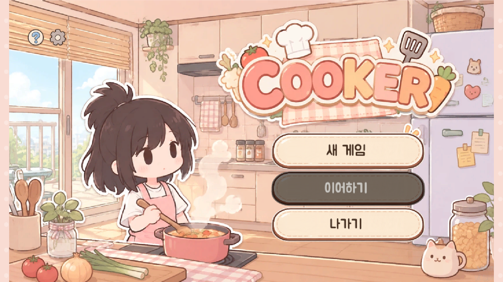
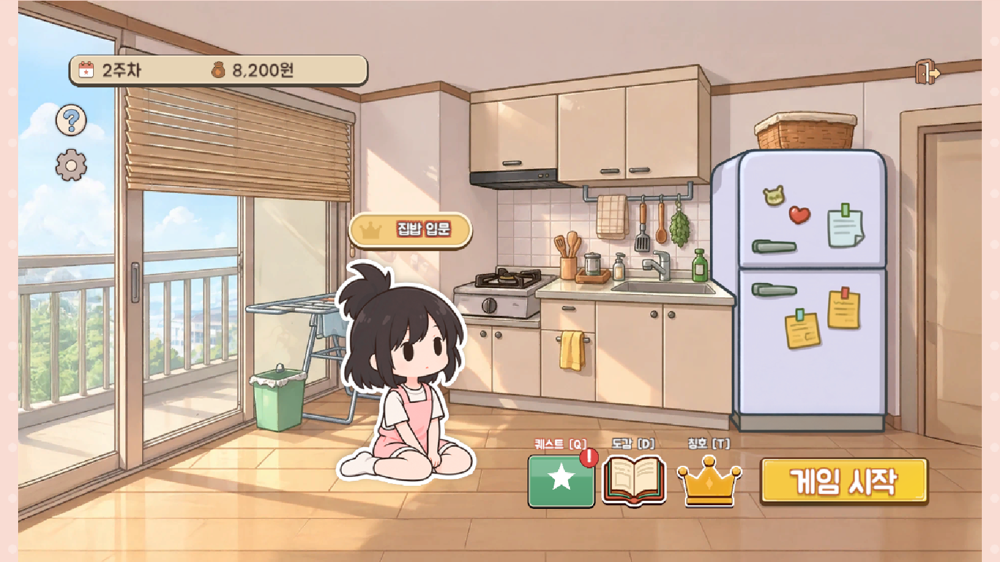
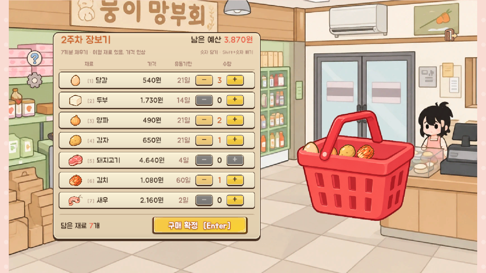
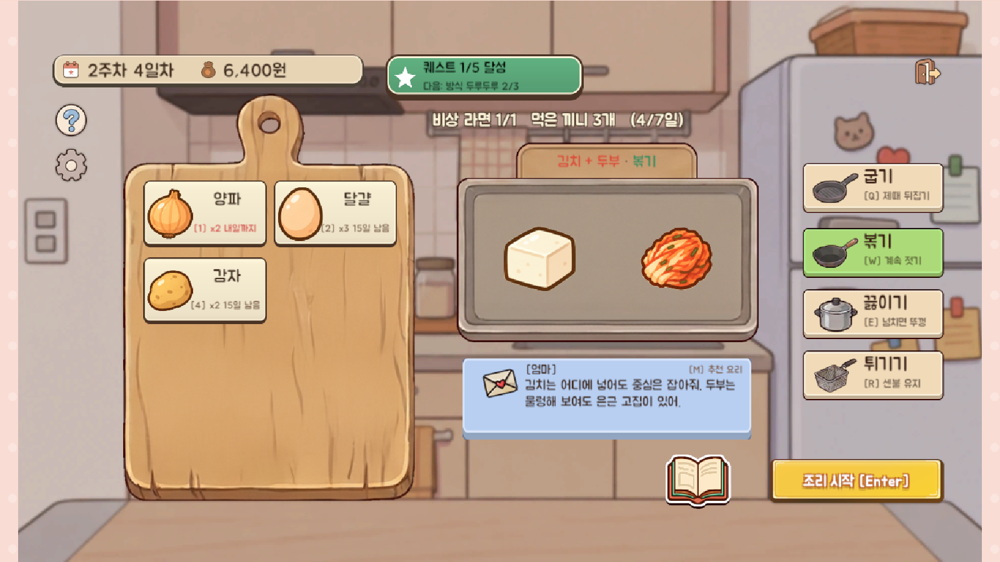
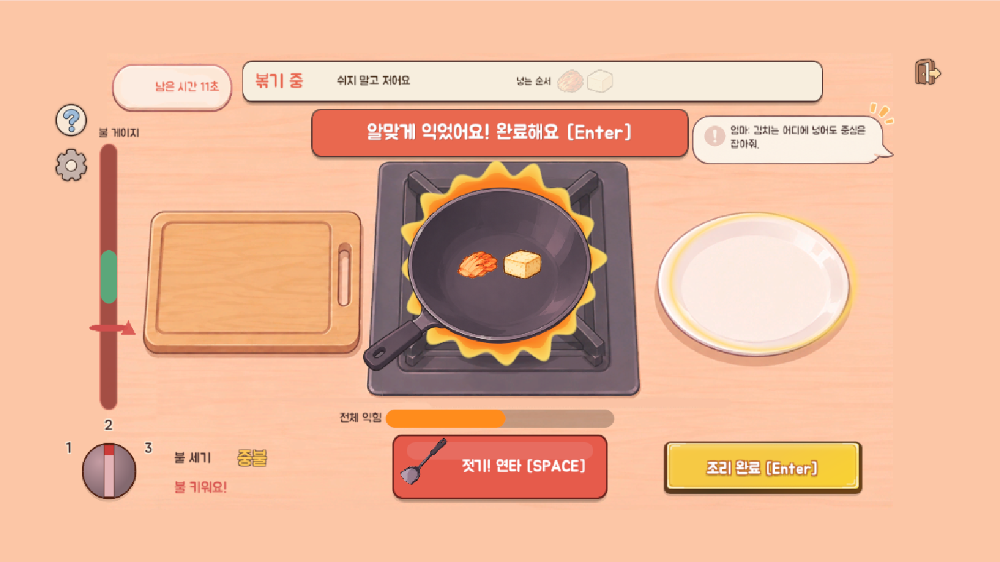
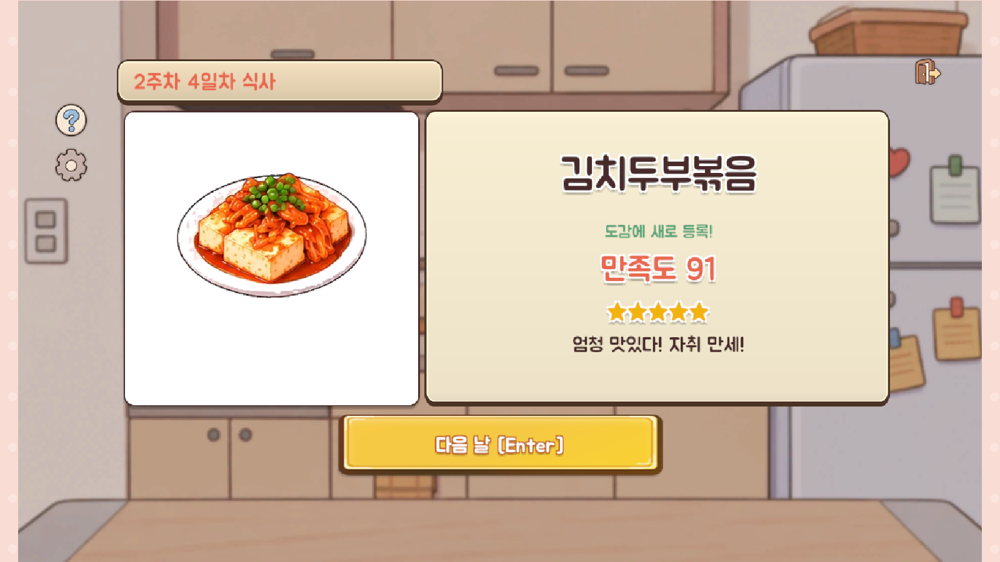
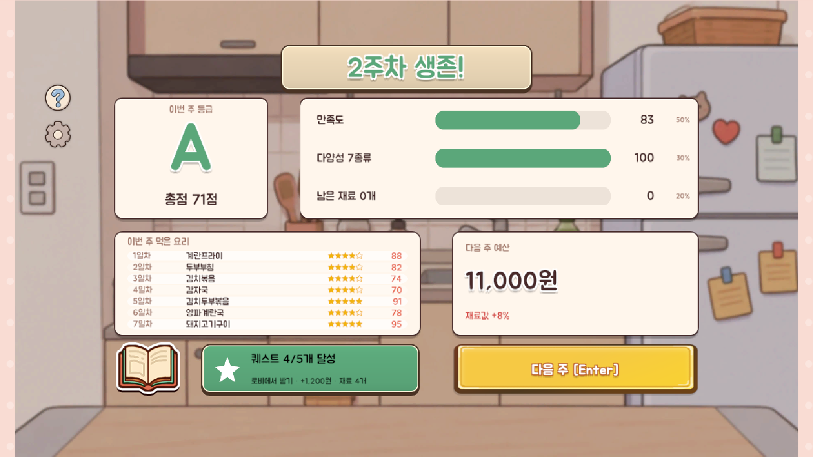
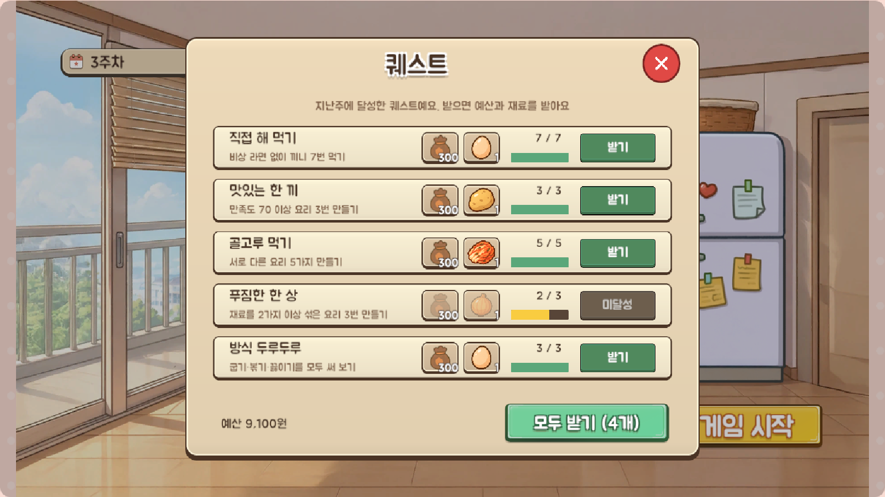
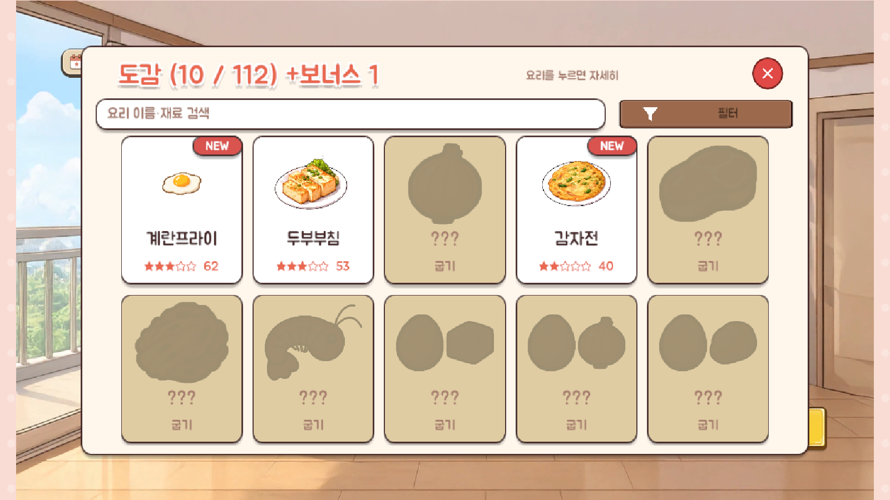

# COOKER

**일주일치 장바구니로 7일을 버티는 코믹 생존 요리 게임.**
장 보고, 아끼고, 직접 해 먹는 자취 초보의 일주일을 게임으로 만들었다.

<p align="center">
  
  
</p>

| | |
|---|---|
| 장르 | 생존 요리 · 자원 관리 · 타이밍 조작 |
| 플랫폼 | Windows PC (마우스와 키보드) |
| 엔진 | Unity 6000.3.22f1, 2D Universal (URP), C# |
| 분량 | 한 주(7일)는 10분 안팎. 주차를 이어 가며 얼마나 오래 버티는지가 점수 |
| 성격 | 학교 기말 프로젝트 (2026-11-17 ~ 12-01), 3명 |

## 어떤 게임인가

자취를 막 시작한 주인공은 엄마가 보내 준 달걀 하나와 일주일치 용돈밖에 없다.
돈은 한정되어 있고 재료는 상한다. 하루라도 먹을 게 없으면 굶는다.
무엇을 사서 7일에 어떻게 나눠 먹을지 정하고, 불 앞에서 직접 요리한다.

- **계획**: 한정된 예산으로 어떤 재료를 얼마나 살까? 유통기한이 짧은 것부터 먹어야 한다.
- **조작**: 불을 조절하고, 뒤집고, 젓고, 뚜껑을 눌러 가며 알맞게 익힌 순간에 꺼낸다.
- **수집**: 만든 요리는 도감에 남고, 모을수록 칭호와 새 재료가 열린다.
- **압박**: 한 주를 버텨도 다음 주는 재료값이 오른다. 언젠가는 굶는다. 얼마나 버틸까?

## 한 판의 흐름

```
로비 → 장보기 → [ 하루 선택 → 조리 → 간 고르기 → 식사 ] × 7일 → 주 결산 → 로비 (다음 주)
```

<table>
<tr>
<td width="50%"><br><b>① 장보기</b><br>주 시작에 한 번, 예산 안에서 7끼를 채운다. 값과 유통기한을 보고 고른다. 남은 재료는 다음 주로 이어진다.</td>
<td width="50%"><br><b>② 하루 선택</b><br>오늘 쓸 재료를 철판에 올리고 굽기·볶기·끓이기·튀기기 중 방식을 고른다. 엄마의 한마디가 힌트가 된다.</td>
</tr>
<tr>
<td width="50%"><br><b>③ 조리</b><br>가스 밸브로 불을 조절해 왼쪽 게이지 바늘을 초록 구간에 맞추고, 방식마다 다른 동작을 한다. 알맞게 익은 순간에 꺼낸다.</td>
<td width="50%"><br><b>④ 식사</b><br>만족도를 별 5개로 보여 준다. 점수가 낮으면 무엇이 아쉬웠는지 알려 주고, 새 요리는 도감에 등록된다.</td>
</tr>
<tr>
<td width="50%"><br><b>⑤ 주 결산</b><br>만족도·다양성·남은 재료로 등급(S~C)을 매기고, 그 성적이 다음 주 예산이 된다.</td>
<td width="50%"><br><b>⑥ 퀘스트</b><br>한 주 동안 달성한 퀘스트는 다음 주 로비에서 받는다. 받으면 예산과 재료가 늘어난다.</td>
</tr>
</table>

## 특징

### 조리가 손맛 있다
- **불 게이지와 가스 밸브**: 밸브를 돌려 불 세기(약·중·강)를 바꾸면 게이지 바늘이 오르내린다. 바늘이 초록 구간을 벗어나면 경고가 뜨고 점수가 깎인다.
- **방식마다 다른 동작**
  - 굽기: 뒤집기 버튼이 뜨는 순간에 눌러야 한다.
  - 볶기: 쉬지 않고 연타해서 저어야 한다. 멈추면 눌어붙는다.
  - 끓이기: 거품이 올라오면 뚜껑을 눌러 가라앉힌다. 놓치면 끓어넘친다.
  - 튀기기: 기름 온도를 유지하려면 센불을 지켜야 한다. 기름과 거품이 튀는 연출이 붙는다.
- **재료마다 익는 속도가 다르다**: 달걀은 빠르고 감자는 느리다. 속도가 크게 다른 재료를 같이 고르면 한쪽을 망치기 쉽다. 하루 선택 화면이 미리 알려 준다.
- **전체 익힘 막대**: 팬의 익힘을 막대 하나로 보여 준다. 주황일 때 꺼내면 된다.
- **재료 넣는 순서와 시간 제한**: 순서를 틀리면 맛이 깎이고, 제한 시간을 넘기면 감점이다.
- **간 고르기**: 조리를 마치면 소금·간장·고춧가루 같은 선택지 중 이 요리에 맞는 간을 고른다. 처음 두 주는 엄마가 힌트를 준다.

### 아끼는 맛이 있다
- 첫 주는 10,000원으로 시작한다. 다음 주 예산은 `6,000원 + 평균 만족도 × 60원` (6,000~12,000원)이다.
- 재료값은 매주 8% 오른다. 가격과 유통기한은 실제 소매가와 소비기한에 맞췄다.
- 돼지고기는 점수가 높지만 비싸고 나흘이면 상한다. 달걀과 양파는 싸고 오래 간다.
- 먹을 게 없으면 주마다 한 번 **엄마 몰래 비상 라면**으로 넘어갈 수 있다. 두 번째부터는 굶는다. (실패)
- 1주차는 쉽다(적정 구간 넓음, 방식 속도 느림). 4주차에 원래 난이도가 된다.

### 모으는 맛이 있다
- **도감**: 재료 1~3개 × 방식 4개, 252가지 요리 사진이 들어 있다. 못 만든 요리는 어두운 실루엣으로 보인다.
- **칭호 8개**: 도감 수집 수와 방식별 수집 수로 얻는다. "자취 생존자"를 얻으면 **새우와 튀기기가 해금**된다.
- **퀘스트 5개**: 비상 라면 없이 끼니 채우기, 맛있는 한 끼 만들기, 골고루 먹기, 재료 섞기, 방식 두루두루. 달성할 때마다 예산 +300원과 재료 1개를 받는다.
- **엄마의 전언**: 가진 재료로 만들 수 있는 요리와 레시피를 추천해 준다.

<p align="center">
  
</p>

### 점수
한 주의 등급 = **만족도 50% + 메뉴 다양성 30% + 남은 재료 20%**. S 85점, A 70점, B 55점 이상이다.
기록은 "버틴 일수"다. 굶으면 판이 끝나고 타이틀로 돌아간다. 도감과 칭호는 남는다.

## 조작

마우스만으로도, 키보드만으로도 한 판을 끝낼 수 있다. 버튼 글자 안에 `[키]`가 적혀 있다.

| 화면 | 키 |
|---|---|
| 공통 | Enter / Space = 화면의 기본 버튼, D = 도감, Esc = 팝업 닫기 |
| 로비 | Q = 퀘스트, T = 칭호 |
| 장보기 | 숫자 1~7 = 재료 담기, Shift + 숫자 = 빼기, Enter = 구매 확정 |
| 하루 선택 | 재료를 클릭하거나 끌어서 도마 ↔ 철판, Q / W / E / R = 굽기 / 볶기 / 끓이기 / 튀기기, M = 엄마의 전언, Enter = 조리 시작 |
| 조리 | 1 / 2 / 3 = 약불 / 중불 / 강불 (밸브를 돌려도 된다), Z X C V B N = 재료 넣기·꺼내기, Enter = 팬의 재료 모두 꺼내기 |
| 굽기 · 볶기 · 끓이기 | Space = 뒤집기 · 젓기(연타) · 뚜껑(누르고 있기) |
| 간 고르기 | Q / W / E / R |

## 실행

1. Unity Hub에서 이 폴더를 Add하고 **6000.3.22f1**로 연다. (팀 모두 같은 버전)
2. `Assets/Scenes/SampleScene`을 열고 Play를 누른다. 씬에는 `GameFlow`만 있고, 화면은 모두 코드가 그린다.
3. 빌드: File → Build Profiles에서 Windows로 빌드하면 `COOKER.exe`가 나온다. (`Builds/`는 깃에 올리지 않는다.)

- **이어하기**: 하루가 끝날 때마다 자동 저장된다. 도감과 칭호는 따로 저장되어 새 판을 해도 남는다.
- **인터넷 없이 실행된다.** 게임 실행 중에는 AI를 호출하지 않는다.

## 요리 그림과 AI 사용

솔직하게 적는다. 자세한 기록은 [docs/32](docs/32AI요리글생성기록.md)와 [docs/24](docs/24요리그림출처.md)에 있다.

- **실행 중에는 AI를 쓰지 않는다.** 요리 사진, 이름, 레시피는 모두 미리 만들어 파일로 넣었고 게임은 그 파일만 읽는다. 시연에 인터넷이나 API 키가 필요 없다.
- **요리 사진 252장**: ChatGPT 이미지 생성으로 시트를 만들고, 잘라 이름을 붙여 `Assets/Resources/AiDishes/`에 넣었다. 요리 그림 자체는 고치거나 다시 그리지 않았다.
- **요리 이름과 레시피 글 508개**: 일부는 Gemini가, 나머지는 개발 중 Claude가 규칙으로 썼다. 직접 쓴 164개는 문장이 단조롭고, 요리 전문가가 검수한 것은 아니다.
- **기획과 코드**: 기획 정리, 코드 작성, 테스트에 Claude(Claude Code)의 도움을 받았다. 커밋 메시지에 공동 작성자로 남아 있다.
- 재료와 방식 그림, 배경, 소리는 파일 이름 규칙으로 `Assets/Resources/`에서 읽고, 없으면 단색 도형으로 대신 그려 게임이 멈추지 않는다.

## 문서

- **기획**: [01 코어 루프](docs/01코어루프.md) · [02 핵심 메커니즘](docs/02핵심메커니즘.md) · [08 보상 체계와 피드백](docs/08보상체계와피드백반영.md) · [16 칭호와 해금](docs/16칭호와해금.md) · [17 확정 사항](docs/17확정사항_로비칭호튀김.md)
- **수치와 근거**: [09 재료·방식 수치](docs/09재료와방식수치초안.md) (바꾼 값과 이유가 모두 적혀 있다) · [14 가격과 유통기한](docs/14가격과유통기한근거.md)
- **조리 규칙**: [26 불 바늘 게이지](docs/26불바늘게이지명세.md) · [27 전체 익힘](docs/27전체익힘명세.md) · [28 재료 순서](docs/28재료순서명세.md) · [29 간 맞추기](docs/29간맞추기명세.md) · [30 조리 시간 감점](docs/30조리시간감점명세.md)
- **화면**: [화면 목록과 흐름](docs/화면/00화면목록과흐름.md) (화면마다 스크린샷과 기능 정리)
- **아트와 소리**: [13 아트 가이드](docs/13아트가이드.md) · [22 소리 목록](docs/22소리목록.md) · [24 요리 그림 출처](docs/24요리그림출처.md)
- **테스트와 진행**: [11 플레이테스트 체크리스트](docs/11플레이테스트체크리스트.md) · [19 앞으로 할 작업](docs/19앞으로할작업.md) · [33 출시 전 진단](docs/33출시전진단.md)
- **작업 규칙**: [CLAUDE.md](CLAUDE.md) (파일 주인, 커밋 규칙, 저장 이름 규칙)

## 팀

| 이름 | 맡은 일 |
|---|---|
| 유초윤 (팀장) | 전체 흐름(장보기·하루 선택·결산·퀘스트), 조리 판정과 수치, 화면 틀(UI), 저장, 문서 |
| 윤혁진 | 도감, 칭호, 도움말, 튀기기 연출 |
| 영은 | 조리 화면, 로비, 불꽃, 소리, 요리 사진 |

## 프로젝트 구조

화면은 프리팹이 아니라 코드로 그린다. 협업 때 충돌을 줄이려고 `GameFlow`를 화면별 파일로 나눴다.

| 파일 | 내용 |
|---|---|
| `GameFlow.Core.cs` | 전체 흐름: 타이틀, 장보기, 하루 선택, 식사, 주 결산, 굶음 |
| `GameFlow.Cook.cs` · `.CookGauge.cs` · `.CookOrder.cs` · `.CookSeason.cs` | 조리 화면, 불 게이지, 재료 순서 표시, 간 고르기 |
| `GameFlow.Dex.cs` | 도감, 칭호 목록, 냉장고 |
| `GameFlow.Quest.cs` | 퀘스트 (판정, 로비 창, 결산 안내) |
| `Cook.cs` · `Cook.Fire/Order/Season/Time/Whole.cs` | 조리 로직: 익힘, 불 게이지, 재료 순서, 간, 시간 감점, 전체 익힘 |
| `Data.cs` · `Balance.cs` · `BalanceData.cs` | 재료와 방식, 밸런스 수치 (수치는 `Assets/Resources/Data/`의 에셋에서 고친다) |
| `Lobby.cs` · `Titles.cs` · `Recipe.cs` | 로비, 칭호 8개, 엄마의 전언과 요리 이름 |
| `RunSave.cs` · `SaveDir.cs` | 이어하기 저장, 저장 폴더 (에디터와 빌드 분리) |
| `UIKit.cs` · `HudStyle.cs` · `UIExtras.cs` | 코드로 UI를 그리는 도우미 |
| `FireFlame.cs` · `FryFx.cs` · `Sound.cs` | 불꽃, 튀김 연출, 소리 |
