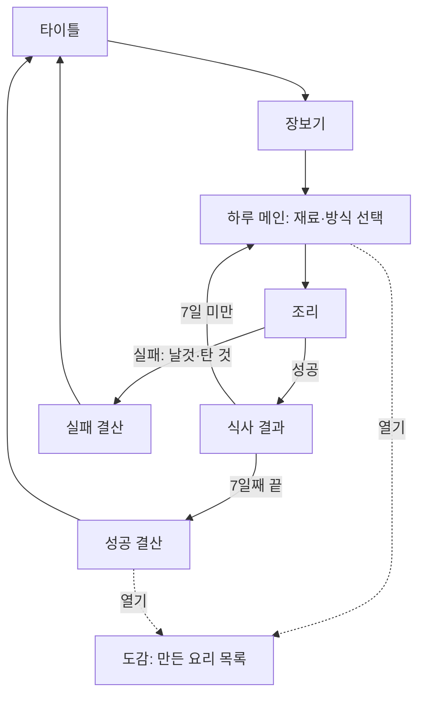

## 개요
3일 프로토타입의 화면 구조(정보 구조)와 UI·기능 우선순위를 정리했다. 근거 문서: [01](01코어루프.md), [04](04턴페이싱.md), [09](09재료와방식수치초안.md). 역할 A·B·C는 [README](../README.md)의 역할 분담과 같다.

## 1. 화면 흐름

- 한 판 흐름은 타이틀 → 장보기 → (하루 메인 → 조리 → 식사 결과) × 7 → 결산이다.
- 도감은 하루 메인과 결산에서 열고 닫는 보조 화면이다.
- 실패하면 즉시 실패 결산으로 가고, 타이틀에서 새 판을 시작한다. (같은 주 재시작은 타이틀 → 장보기로 이어진다.)

## 2. 화면별 구성

| 화면 | 보여줄 정보 | 할 수 있는 행동 |
|---|---|---|
| **타이틀** | 게임 이름 | 시작 |
| **장보기** | 재료 6종(가격, 유통기한, 적합 방식), 남은 예산, 장바구니 | 재료 담기·빼기, 구매 확정 |
| **하루 메인** | 오늘 몇 일차, 보유 재료(남은 유통기한 표시), 선택한 재료·방식, 엄마 힌트 | 재료 1~2개 선택, 방식 선택, 조리 시작, 도감 열기 |
| **조리** | 재료 스프라이트(색 변화), 방식별 도구 연출, 화력 표시 | 불 조절, 방식별 고유 조작, 꺼내기 |
| **식사 결과** | 요리 이름, 만족도, 반응(표정·문구) | 다음 날로 |
| **성공 결산** | 총점(만족도·다양성·남은 재료), 만든 요리 목록 | 도감 열기, 다시 하기 |
| **실패 결산** | 굶은 날과 이유, 그때까지의 기록 | 다시 하기 |
| **도감** | 만든 요리 목록(이름, 재료, 방식, 만족도) | 닫기 |

### 공통 UI
- 상단 바: 일차, 남은 예산 (장보기 이후에는 일차만 표시)
- 첫날 가이드: 하루 메인과 조리 화면 위에 올리는 안내 문구(오버레이)

## 3. 화면 전환 규칙
- 장보기는 한 판에 한 번이다. 구매를 확정하면 되돌릴 수 없다.
- 하루 메인에서 재료가 하나도 없으면 바로 굶음 실패로 이동한다.
- 조리 도중에는 다른 화면으로 나갈 수 없다.
- 도감은 조리 중에는 열지 않는다.

## 4. 기능 우선순위

### P0: 없으면 한 판이 안 돌아간다 (1~2일차 안에 완성)
| 기능 | 담당 |
|---|---|
| 조리 장면: 익힘 값 계산, 화력 3단계, 꺼내기 판정 | A |
| 색 변화 표현(익힘 5단계 스프라이트) | A |
| 굽기 고유 조작(뒤집기) | A |
| 7일 반복 흐름과 화면 전환 | B |
| 장보기(재료 선택, 예산 차감) | B |
| 재료 보유·차감, 유통기한 폐기 | B |
| 굶음 판정과 즉시 종료 | B |
| 만족도 계산과 총점·성공/실패 결산 | B |
| 재료 6종·방식 3개 데이터 표 | C |
| 재료 스프라이트(단색 도형도 가능), 기본 UI 배경 | C |

### P1: 한 판의 재미와 이해를 올린다 (2일차 저녁~3일차 오전)
| 기능 | 담당 |
|---|---|
| 볶기·끓이기와 그 고유 조작 | A |
| 첫날 가이드 오버레이 | B (문구는 C) |
| 도감: 만든 요리 목록 | B |
| 요리 이름 규칙 적용, 다양성 점수 | B |
| 엄마 힌트(사전 작성 문구, 조건 태그 선택) | B (문구는 C) |
| 식사 반응 연출(표정, 문구) | C |
| 장보기·하루 메인 화면 정리(유통기한 색 표시 등) | C |

### P2: 시간이 남으면 (3일차 오후)
| 기능 | 담당 |
|---|---|
| AI 요리 이름·그림 생성 1회 호출 | B |
| 사운드, 효과음 | C |
| 식사 연출 건너뛰기 | B |
| 스프라이트 정식 교체 | C |
| 발표용 화면 정리 | 전원 |

### 이번에는 하지 않음
칭호·영구 버프, 주차 진행, 튀기기·찌기, 모바일 대응, 계정 저장, 방식별 별도 미니게임

## 5. 일정과 우선순위의 연결
| 시점 | 목표 | 완료 기준 |
|---|---|---|
| 1일차 끝 | P0 뼈대 | A: 굽기 한 방식이 조작되고 색이 변한다. B: 빈 화면으로 7일이 돈다. C: 데이터 표와 임시 스프라이트가 있다 |
| 2일차 끝 | P0 전부 + P1 일부 | 장보기부터 결산까지 한 판이 끝까지 돈다 |
| 3일차 오전 | P1 완료 | 3개 방식, 도감, 힌트, 가이드가 들어간다 |
| 3일차 오후 | 검증과 빌드 | 지인 테스트, 수치 조정, 빌드, 발표 화면 |

- 2일차 저녁에 한 판이 안 돌아가면 P1 중 도감과 힌트를 버리고 P0만 남긴다.

## 6. 화면 단위 완료 체크리스트
- [ ] 타이틀에서 시작하면 장보기로 간다
- [ ] 장보기에서 예산 안에서만 구매된다
- [ ] 하루 메인에서 재료·방식을 고르고 조리를 시작할 수 있다
- [ ] 조리에서 꺼내면 성공/실패가 판정된다
- [ ] 식사 결과 후 재료가 차감되고 다음 날로 간다
- [ ] 유통기한이 지난 재료가 폐기된다
- [ ] 굶으면 실패 결산으로 가고 다시 시작할 수 있다
- [ ] 7일째 끝에 총점이 나온다

## 미해결
- 장보기 화면의 재료 가격·유통기한을 모두 보여줄지, 적합 방식은 숨길지 (적합 방식은 학습 요소라 처음엔 숨기는 쪽이 원래 기획에 맞다)
- 하루 메인에서 보유 재료의 유통기한 표시 방식 (숫자 또는 색)
- 실패 결산에서 보여줄 정보의 범위
