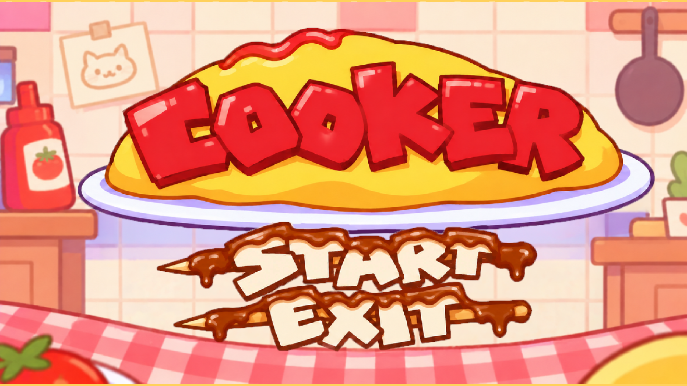

# 01 타이틀

게임을 켜면 처음 나오는 화면. 새 판을 시작하거나 게임을 끈다. (도감·칭호는 로비에서 연다)

## 버튼
| 버튼 | 동작 | 단축키 |
|---|---|---|
| START | 새 판을 시작하고 로비로 간다 | Enter / Space |
| EXIT | 게임을 끈다 (에디터에서는 플레이 종료) | |

## 정보 표시
- 게임 로고

## 쓰는 이미지
| 파일 | 내용 |
|---|---|
| `bg_title.png` | 배경 |
| `title_logo.png` | 로고 |
| `title_start.png` | START 글자 |
| `title_exit.png` | EXIT 글자 |

- 로고·START·EXIT 세 장이 모두 있어야 그림 버전이 나온다. 하나라도 없으면 글자만 있는 기본 화면("COOKER"와 한 줄 설명, 시작 버튼)이 나온다.
- START와 EXIT를 누르거나 마우스를 올리면 그림이 어두워진다.

## 참고
- "다시 하기"(굶음 실패)가 이 화면으로 돌아온다.
