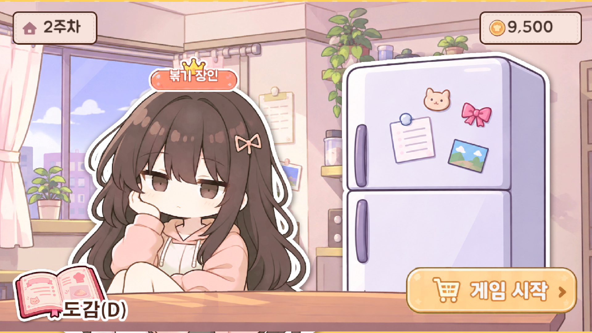

# 02 로비

한 판의 거점. 타이틀 다음, 그리고 **한 주 결산이 끝날 때마다** 돌아온다. 장보기로 가기 전에 상태를 확인하고, 도감·칭호·냉장고를 열어 볼 수 있다.

## 버튼
| 버튼 | 동작 | 단축키 |
|---|---|---|
| 게임 시작 | 장보기로 간다 | Enter / Space |
| 도감 | 도감 팝업을 연다 | D |
| 캐릭터 | 칭호 목록 팝업을 연다 | T |
| 대표 칭호 표시 | 눌러도 칭호 목록이 열린다 | T |
| 냉장고 | 냉장고 팝업(가진 재료)을 연다 | |

- 캐릭터와 냉장고는 마우스를 올리면 아주 살짝 커진다. 도감·게임 시작·칭호칸은 올리면 살짝 어두워지고, 누르면 조금 내려앉는다.

## 정보 표시
| 항목 | 내용 |
|---|---|
| 현재 주차 | "N주차" |
| 보유 금액 | 이번 주 예산 (숫자만, 동전 그림이 옆에 있다) |
| 대표 칭호 | 캐릭터 머리 위. 대표로 고른 칭호 이름이 들어가고, 없으면 "칭호 없음". 칭호 목록에서 대표를 바꾸면 바로 바뀐다 |

## 쓰는 이미지
| 파일 | 내용 |
|---|---|
| `lobby_bg.png` | 방 안 배경 |
| `lobby_desk.png` | 책상 |
| `lobby_character.png` | 주인공 캐릭터 (칭호 버튼) |
| `lobby_fridge.png` | 냉장고 (재료 보관함 버튼) |
| `lobby_titletag.png` | 대표 칭호가 들어가는 틀 (글자는 코드로 넣는다) |
| `lobby_day.png` | 주차 카드 틀 |
| `lobby_money.png` | 금액 카드 틀 |
| `lobby_dex.png` | 도감 버튼 (글자 "도감(D)" 포함) |
| `lobby_start.png` | 게임 시작 버튼 (글자 포함) |

- 배경 그림이 없으면 글자만 있는 기본 화면(로비 제목, 주차·금액 카드, 도감·칭호·냉장고·게임 시작 버튼)이 나온다.

## 동작
- 주가 끝나 돌아오면 **칭호 획득 팝업**이 먼저 뜬다 (새로 얻은 칭호가 있을 때만). 닫으면 일반 로비가 된다.
- 첫 판 시작 직후에는 1주차와 시작 예산이 보인다.

## 참고
- 판 도중 화면에서 [로비] 버튼으로 오면 이번 주차가 취소된다 (확인 창이 먼저 뜬다). 취소 뒤 [게임 시작]은 장보기부터 다시 시작한다.
