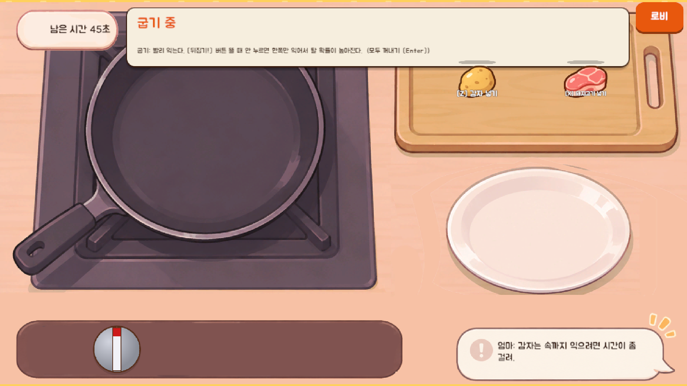
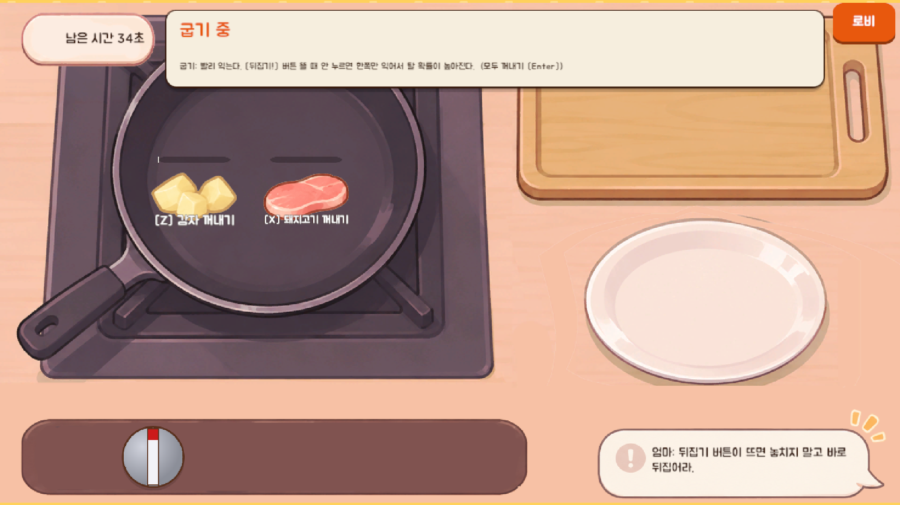
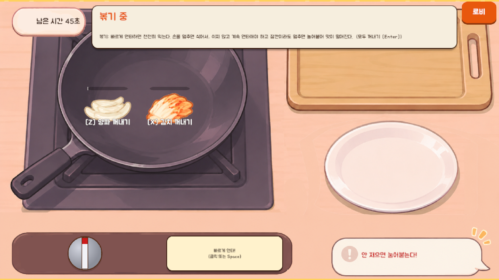
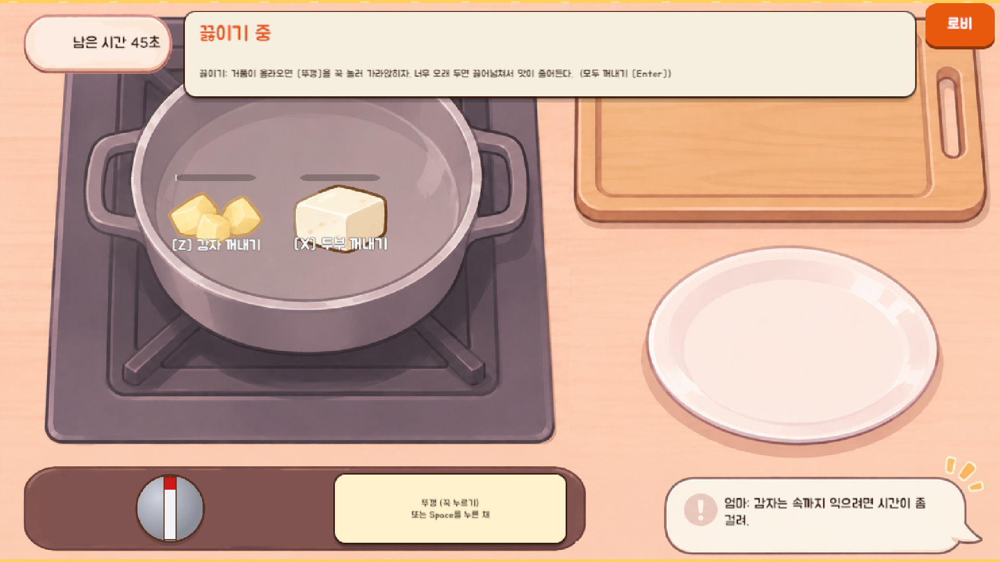
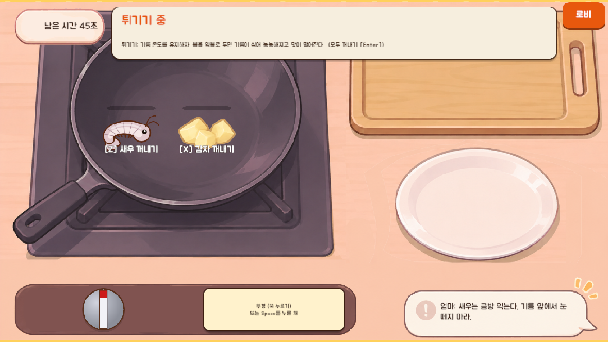

# 05 조리

고른 재료를 팬·웍·냄비에 넣어 익히고 **알맞게 익었을 때** 꺼내 접시에 올린다. 방식(굽기·볶기·끓이기·튀기기)마다 배경과 고유 조작이 다르고, 나머지는 같다.

## 공통 기능

### 입력과 버튼
| 항목 | 동작 | 단축키 |
|---|---|---|
| 도마(트레이) 위 재료 | **클릭하거나 팬으로 끌어다 놓으면** 팬에 넣는다 | Z X C V B N (재료 순서) |
| 팬 위 재료 | **클릭하거나 접시·도마로 끌어다 놓으면** 꺼낸다 | 같은 키 |
| 불 조절 손잡이 (가스 밸브) | 돌려서 약불 / 중불 / 강불을 고른다 | 숫자 1 · 2 · 3 |
| 모두 꺼내기 | 팬에 있는 재료를 전부 접시로 꺼내고 조리를 끝낸다 | Enter |
| 로비 | 확인 창을 띄운다. 가면 **조리 중인 재료가 복구되지 않고 이번 주차가 취소**된다. 창이 떠 있는 동안 조리는 멈춘다 | |

- 팬에서 접시로 꺼낸 재료는 다시 넣을 수 없다. 끌어다 놓는 곳이 엉뚱하면 제자리로 돌아간다.
- **조리 끝**: 팬에 재료가 하나도 남지 않거나, 제한 시간(45초)이 다 되면 끝난다.
- 그림이 없으면(배경이 없을 때) 불 세기는 [1] 약불 · [2] 중불 · [3] 강불 버튼 세 개로 바뀐다.

### 정보 표시
| 항목 | 내용 |
|---|---|
| 방식 이름 | "굽기 중" 등 |
| 방식 설명 | 그 방식의 조작 요령 한 줄 (첫날은 "[첫날 가이드]"가 붙는다) |
| 남은 시간 | 초 단위 |
| 익힘 게이지 | 재료마다 하나. 색이 단계에 따라 바뀐다 (주황일 때 꺼내는 것이 좋다) |
| 재료 그림 | 익는 정도에 따라 5단계로 바뀐다: 날것 → 덜 익음 → 알맞음 → 너무 익음 → 탐 |
| 재료 이름표 | "[키] 재료 넣기" / "[키] 재료 꺼내기" / 접시에 올린 뒤에는 이름만 |
| 말풍선 | 급한 일이 없으면 엄마의 조언이 몇 초마다 바뀌며 나온다. 급한 일이 있으면 붉은 경고 문구로 바뀐다 |

경고 문구: "지금 뒤집어야 한다!", "안 저으면 눌어붙는다!", "거품이 넘친다! 뚜껑을 눌러!", "불이 약하다! 기름이 식는다!", "뒤집을 때를 놓쳤다... 한쪽만 익었다", "국이 끓어넘쳤다... 맛이 줄었다", "기름이 식어서 눅눅해졌다..."

### 쓰는 이미지 (공통)
| 파일 | 내용 |
|---|---|
| `bg_cook_grill.png` | 굽기 배경 (팬) |
| `bg_cook_wok.png` | 볶기 배경 (웍). **튀기기도 전용 그림이 없어 이것을 임시로 쓴다** |
| `bg_cook_pot.png` | 끓이기 배경 (냄비) |
| `bg_cook_fry.png` | 튀기기 배경 (아직 없음. 넣으면 자동으로 쓴다) |
| `cook_timer.png` | 남은 시간 표시 틀 |
| `cook_burner_bar.png` | 불 조절 줄 |
| `cook_tip.png` | 엄마 말풍선 |
| `<재료>_raw / under / good / over / burnt.png` | 재료의 익힘 5단계 그림 |
| `<재료>_shop.png` | 아직 팬에 넣기 전(도마 위) 재료 그림 |

- 세 배경은 도마·접시·버너의 자리가 같아야 한다.
- 불 조절 손잡이와 불꽃은 코드로 그린 것이다.

## 방식별 고유 조작
| 방식 | 조작 | 정보 | 쓰는 이미지 |
|---|---|---|---|
| 굽기 | 중간에 뒤집을 때가 오면 **[뒤집기!] 버튼**이 나타난다. 누르면 뒤집힌다 (놓치면 한쪽만 익어 탈 확률이 높아진다) | "지금 뒤집어야 한다!" 경고 | `cook_flip_btn.png` |
| 볶기 | **빠르게 연타**(칸 클릭 또는 Space)해서 계속 젓는다. 멈추면 눌어붙어 만족도가 깎인다 | "안 저으면 눌어붙는다!" 경고 | |
| 끓이기 | 거품이 넘칠 때 **뚜껑 칸을 꾹 눌러서**(또는 Space를 누른 채) 가라앉힌다. 넘치면 만족도가 깎인다 | 뚜껑 칸이 거품일 때 붉게 변한다. "거품이 넘친다!" 경고 | |
| 튀기기 | 별도 버튼이 없다. **불을 약불로 오래 두면 기름이 식어 눅눅해져** 만족도가 깎인다 (불 조절로 온도를 유지) | "불이 약하다! 기름이 식는다!" 경고 | |

## 결과
- 성공한 재료가 하나라도 있으면 **식사 화면**으로 간다. 망친 재료는 버려지고 안내 문구가 붙는다.
- 전부 날것이거나 탔으면 **망친 요리 화면**으로 간다.
- 아무것도 접시에 올리지 못하면 비상 라면(또는 굶음).
- 첫날은 실패해도 재료가 소모되지 않고 하루 선택으로 돌아간다.
