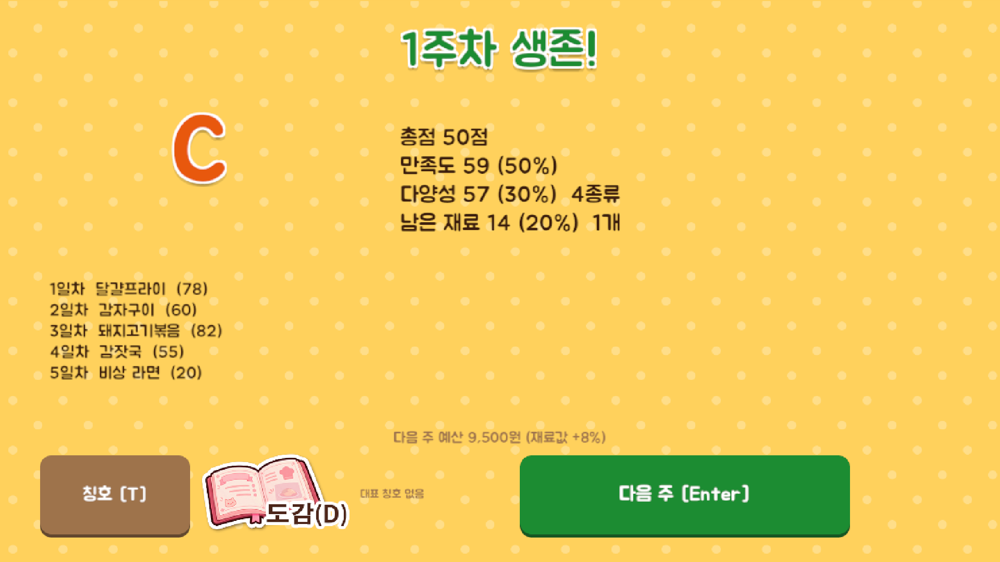

# 08 주 결산

한 주(7일)를 버텼을 때 보이는 결산 화면. 점수와 등급을 보여 주고 다음 주 예산이 정해진다.

## 버튼
| 버튼 | 동작 | 단축키 |
|---|---|---|
| 다음 주 | 로비로 간다 (다음 주 1일차 준비) | Enter |
| 도감 (그림 버튼) | 도감 팝업을 연다 | D |

- 칭호 버튼과 대표 칭호는 이 화면에 없다. **칭호는 로비에서만** 본다.

## 정보 표시
| 항목 | 내용 |
|---|---|
| 제목 | "N주차 생존!" |
| 등급 | S / A / B / C |
| 총점 | 만족도 50% + 다양성 30% + 남은 재료 20% |
| 세부 점수 | 만족도(평균), 다양성(먹은 서로 다른 요리 종류 수), 남은 재료(산 재료 대비 남은 비율, 개수) |
| 이번 주 요리 목록 | 일차별 요리 이름과 만족도 |
| 다음 주 예산 | 이번 주 평균 만족도에 따라 정해지고, 재료값 인상률도 같이 보인다 |

## 참고
- 이 화면에는 [로비] 버튼이 없다. 끝난 주를 취소하는 일이 없도록, [다음 주]가 로비로 가는 길이다.

## 동작
- 이 화면이 나올 때 **칭호 달성 여부를 판정**한다. 새로 얻은 칭호는 여기서 바로 알리지 않고, **다음 주 로비에 들어갈 때** 칭호 획득 팝업으로 보여 준다.
