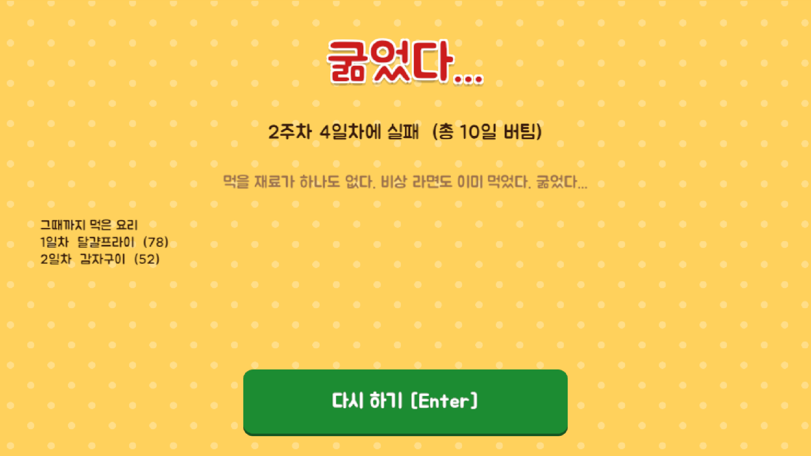

# 09 굶음(실패)

비상 라면(주 1회)을 이미 썼는데 또 먹을 것이 없을 때 나오는 **판이 끝나는 화면.**

## 버튼
| 버튼 | 동작 | 단축키 |
|---|---|---|
| 다시 하기 | 타이틀로 간다 (새 판은 타이틀에서 시작) | Enter |

## 정보 표시
| 항목 | 내용 |
|---|---|
| 제목 | "굶었다..." |
| 실패 위치 | "N주차 N일차에 실패 (총 N일 버팀)" |
| 사유 | 재료가 없거나 요리를 망친 이유 |
| 그때까지 먹은 요리 | 일차별 요리 이름과 만족도. 없으면 "먹은 요리가 없다." |

## 동작
- 이 화면에서도 **칭호를 판정**한다. 새로 얻은 칭호는 다음 판 로비에서 팝업으로 알린다.
- 도감과 칭호는 판이 끝나도 남는다 (저장 파일).
