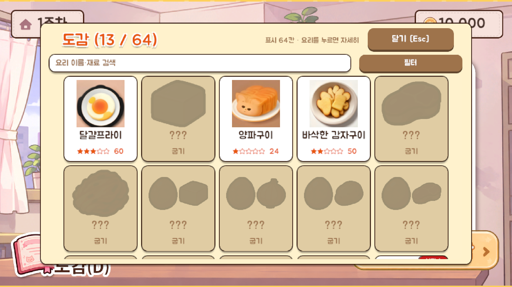
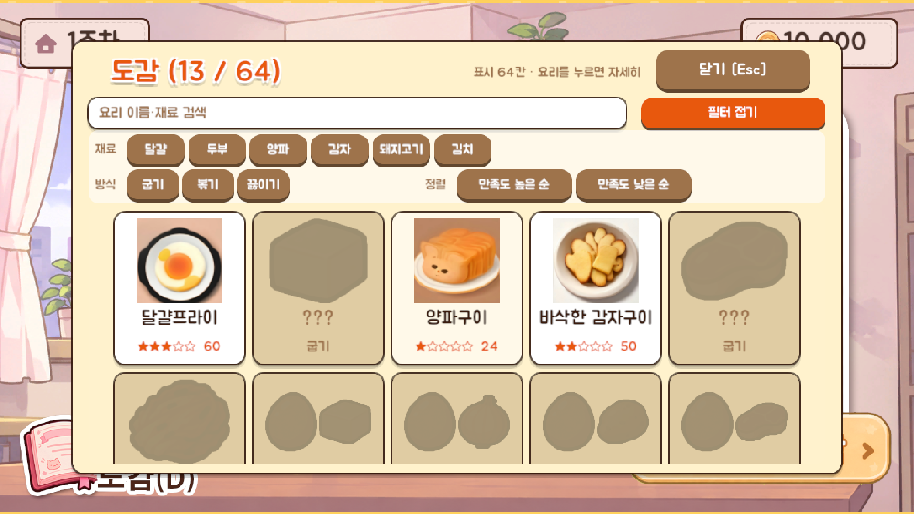

# 10 도감 (팝업)

만들 수 있는 **모든 재료·방식 조합을 칸으로 보여 주고, 만들어 본 요리만 채워지는** 수집 화면. 로비·하루 선택·주 결산에서 열 수 있다 (단축키 D). 타이틀에서는 열 수 없다.

## 버튼과 입력
| 항목 | 동작 |
|---|---|
| 닫기 | 팝업을 닫는다 (Esc) |
| 검색창 | 요리 이름·재료로 검색. 글자를 치는 동안은 단축키가 꺼진다. 못 만든 요리는 이름을 모르니 검색에서 빠진다 |
| 필터 토글 | 누르면 필터 칸이 펼쳐지고 다시 누르면 접힌다. 켠 필터 수가 버튼에 "(N)"으로 보인다 |
| 재료 칩 (필터 칸) | 여러 개 켜면 그 재료가 **모두** 들어간 요리만 보인다 (켜진 칩은 색이 다르다) |
| 방식 칩 (필터 칸) | 굽기 / 볶기 / 끓이기 (해금 후 튀기기) 중 하나만 보인다 |
| 정렬 칩 (필터 칸) | 만족도 높은 순 / 낮은 순. 켜면 그 순서로 정렬 (다시 누르면 해제). 만든 요리가 먼저 나온다 |
| 요리 카드 | 만든 요리를 누르면 [도감 상세] 팝업이 열린다 |
| 스크롤 | 칸이 많아서 위아래로 넘겨 본다 |

## 정보 표시
| 항목 | 내용 |
|---|---|
| 제목 | "도감 (만든 수 / 전체 칸 수)" |
| 안내 | "표시 N칸 · 요리를 누르면 자세히" (조건에 맞는 요리가 없으면 "조건에 맞는 요리가 없다.") |
| 만든 요리 카드 | 요리 사진, 이름, 별과 최고 만족도 |
| 못 만든 요리 카드 | 사진이 실루엣, 이름은 "???", 아래에 방식 이름만 보인다. 누를 수 없다 |
| NEW 표시 | 새로 등록됐고 아직 열어 보지 않은 요리. 카드를 열면 사라진다 |

## 칸의 구성
- 재료 1개 또는 2개 × 조리 방식으로 가능한 조합 전부가 칸이다.
- **튀김과 새우는 "자취 생존자" 칭호를 얻기 전에는 칸·칩에 나타나지 않는다.** 얻은 뒤에 칸이 늘어난다.
- 재료를 3개 이상 써서 만든 요리는 만든 뒤에 칸이 덧붙는다.
- 도감은 파일로 저장돼 판이 끝나도, 게임을 껐다 켜도 남는다.

## 쓰는 이미지
- 요리 사진은 AI가 그린 그림이다. 그림이 오기 전과 못 만든 칸은 재료 색으로 칠한 대체 그림·실루엣이다. (별도 이미지 파일 없음)
