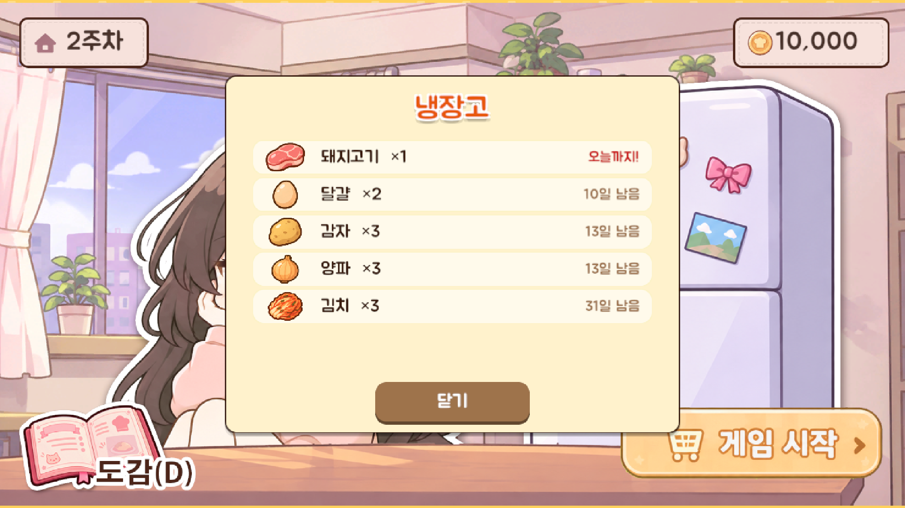

# 14 냉장고 (팝업)

로비의 냉장고 그림을 누르면 뜨는 창. **지금 가진 재료와 남은 유통기한**을 확인한다.

## 버튼
| 버튼 | 동작 | 단축키 |
|---|---|---|
| 닫기 | 팝업을 닫는다 | Esc / Enter / Space |

## 정보 표시
| 항목 | 내용 |
|---|---|
| 제목 | "냉장고" |
| 재료 목록 | 재료마다 한 줄: **재료 그림**, 이름과 개수("달걀 ×2"), 남은 유통기한("N일 남음", 오늘까지면 붉은 "오늘까지!"). 유통기한이 급한 재료가 위에 온다 |
| 빈 냉장고 | 재료가 없으면 "텅 비었다. 장보기에서 재료를 사 오자." |

## 쓰는 이미지
| 파일 | 내용 |
|---|---|
| `<재료>_shop.png` | 재료 줄의 재료 아이콘 (장보기와 같은 그림) |

## 참고
- 한 주가 끝나고 로비로 돌아왔을 때, 이월된 재료를 확인하는 용도다.
- 목록의 글자와 레이아웃은 임시다. 디자인 단계에서 냉장고가 열린 모습(`lobby_fridge_open` 같은 그림)으로 바꿀 수 있다.
