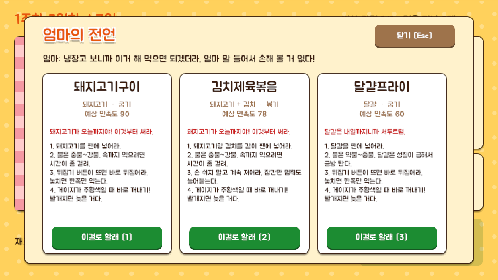

# 15 엄마의 전언 (팝업)

하루 선택 화면에서 열 수 있는 **추천 요리 창.** 가진 재료로 만들 수 있는 요리를 엄마가 최대 3개 권해 준다. 첫날 가이드에서는 열 수 없다.

## 버튼
| 버튼 | 동작 | 단축키 |
|---|---|---|
| 이걸로 할래 (추천마다 하나) | 그 추천의 재료와 방식을 하루 선택에 채워 넣고 창을 닫는다 | 숫자 1 · 2 · 3 |
| 닫기 | 팝업을 닫는다 | Esc / M |

## 정보 표시
| 항목 | 내용 |
|---|---|
| 엄마의 한마디 | 추천이 있으면 "냉장고 보니까 이거 해 먹으면 되겠더라…", 재료가 없으면 "냉장고가 텅 비었네... 비상 라면이라도 챙겨 먹어라." |
| 추천 요리 카드 | 요리 이름, 재료 + 방식, 예상 만족도 |
| 급한 이유 | 유통기한이 오늘/내일까지인 재료가 있으면 붉은 글씨로 알린다 |
| 요령 | 번호 매긴 **게임 조작 요령** (불 세기, 뒤집기·젓기·뚜껑 등). 실제 레시피는 도감 상세에서 본다 |

## 추천 기준
- 재료와 방식이 잘 맞아 만족도가 높은 것, 그리고 유통기한이 급한 재료를 먼저 쓰는 것을 우선한다.
- 한 재료는 추천 두 개까지만 나온다. 아직 해금되지 않은 방식(튀기기)은 권하지 않는다.
